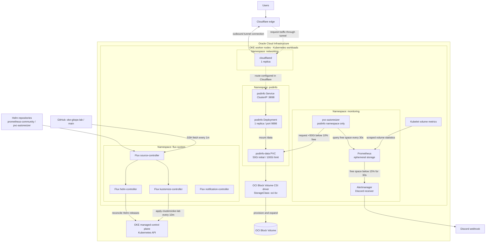

# OKE GitOps Lab

Kubernetes lab deployed to **Oracle Cloud Infrastructure (OCI) Container Engine for Kubernetes (OKE)** and managed with Flux. This repository defines the in-cluster workloads, networking connector, monitoring, and automatic persistent volume expansion.

## Cluster architecture

The diagram shows the logical architecture represented by the manifests. OKE control plane and worker nodes are the hosting platform; their provisioning, node counts, shapes, subnets, and OCI networking are configured outside this repository.



The dotted application traffic path requires a Cloudflare Tunnel route configured outside this repository. The `cloudflared` manifest supplies a tunnel token but does not define a public hostname or origin route. The podinfo origin Service is `http://podinfo.podinfo.svc.cluster.local:9898`.

## Repository layout

```text
clusters/oke-lab/
├── kustomization.yaml                 # Cluster entry point
├── flux-system/
│   ├── gotk-components.yaml           # Flux controllers, CRDs, RBAC, policies
│   ├── gotk-sync.yaml                 # Git source and Flux reconciliation
│   └── kustomization.yaml
├── networking/
│   ├── cloudflared.yaml               # Cloudflare Tunnel connector
│   └── kustomization.yaml
├── podinfo/
│   ├── app.yaml                       # Deployment, Service, and PVC
│   └── kustomization.yaml
└── monitoring/
    ├── prometheus.yaml                # Prometheus and Alertmanager Helm release
    ├── pvc-autoresizer.yaml           # PVC autoresizer Helm release
    ├── storageclass-autoresize.yaml   # OCI Block Volume expansion settings
    └── kustomization.yaml
```

## GitOps reconciliation

Flux fetches the `main` branch of `ssh://git@github.com/vmoogala/oke-gitops-lab` every minute. Its root Flux Kustomization applies `./clusters/oke-lab` every 10 minutes with pruning enabled. The cluster entry point includes Flux itself, networking, podinfo, and monitoring.

The source controller fetches Git and Helm artifacts, the Kustomize controller applies manifests, and the Helm controller manages the monitoring releases. The notification controller is also installed. Helm repositories refresh hourly, and both Helm releases reconcile every 10 minutes.

| Component | Configuration in this repository |
| --- | --- |
| Cloudflare Tunnel | `cloudflare/cloudflared:latest`, one replica, token from a Secret |
| podinfo | `ghcr.io/stefanprodan/podinfo:6.15.0`, one replica, `Recreate` strategy, health probes |
| Prometheus | `prometheus` chart `29.40.3`; 30s scrape and rule evaluation intervals |
| Alertmanager | Enabled through the Prometheus chart; Discord notifications including resolved alerts |
| PVC autoresizer | `pvc-autoresizer` chart `0.20.*`; checks the `podinfo` namespace every 30s |

## Storage and monitoring

The `podinfo-data` PVC starts at **50Gi**, uses `ReadWriteOnce`, and mounts at `/data`. Its `oci-bv` StorageClass uses `blockvolume.csi.oraclecloud.com`, permits volume expansion, and waits for the first consumer before binding. The StorageClass is marked as the default and enabled for autoresizing.

The storage feedback loop is configured as follows:

1. Prometheus collects kubelet volume statistics.
2. `PodinfoPVCFreeSpaceLow` fires when the PVC has less than **15% free space** for **30 seconds**.
3. Alertmanager sends the alert to the configured Discord webhook.
4. PVC autoresizer queries Prometheus and requests an additional **50Gi** when free space falls below **10%**, up to a **100Gi** storage limit.
5. The OCI CSI driver handles the requested volume expansion.

The PVC uses Flux's `IfNotPresent` apply policy so subsequent reconciliation does not overwrite the controller-managed claim size. The StorageClass uses Flux merge behavior and is excluded from pruning. Its volume reclaim policy is `Delete`.

Prometheus uses ephemeral `emptyDir` storage, with a 5Gi size limit, 24-hour retention, and a 2GB retention size setting. Alertmanager persistence is disabled. Prometheus history and Alertmanager state therefore do not survive pod replacement. The chart's kube-state-metrics, node-exporter, and pushgateway are disabled.

## External prerequisites

This repository assumes an existing OKE cluster with worker capacity, the OCI Block Volume CSI driver, and the permissions and connectivity needed to provision and expand volumes. It contains no OCI infrastructure provisioning code.

The following Secrets must be supplied separately; their contents are not committed here:

| Namespace | Secret | Required key | Purpose |
| --- | --- | --- | --- |
| `flux-system` | `flux-system` | SSH authentication material appropriate for Flux | Authenticate to the Git repository, normally created during Flux bootstrap |
| `networking` | `cloudflared-token` | `token` | Authenticate the Cloudflare Tunnel connector |
| `monitoring` | `discord-webhook` | `webhook-url` | Supply the Alertmanager Discord webhook URL |

Cloudflare Tunnel setup, hostname routing, and the Discord webhook are managed externally. The configured workloads also need outbound access to GitHub, container registries, Helm repositories, Cloudflare, and Discord as applicable.

## Inspect and reconcile

With `kubectl` configured for the OKE cluster and the Flux CLI installed:

```bash
# Render the repository's complete cluster configuration locally.
kubectl kustomize clusters/oke-lab

# Inspect GitOps reconciliation and Helm releases.
flux get sources git -n flux-system
flux get kustomizations -n flux-system
flux get helmreleases -A

# Inspect workloads and persistent storage.
kubectl get pods -A
kubectl get pvc -n podinfo
kubectl get storageclass oci-bv

# Fetch the latest Git revision and request reconciliation now.
flux reconcile kustomization flux-system -n flux-system --with-source
```

For local access to podinfo or Prometheus, run either port forward in a separate terminal:

```bash
kubectl -n podinfo port-forward svc/podinfo 9898:9898
kubectl -n monitoring port-forward svc/prometheus-server 9090:80
```

Open podinfo at `http://localhost:9898` or Prometheus at `http://localhost:9090`. In Prometheus, inspect `kubelet_volume_stats_available_bytes` and `kubelet_volume_stats_capacity_bytes` for `namespace="podinfo"` and `persistentvolumeclaim="podinfo-data"` to verify that the metrics needed for alerting and autoresizing are available.
